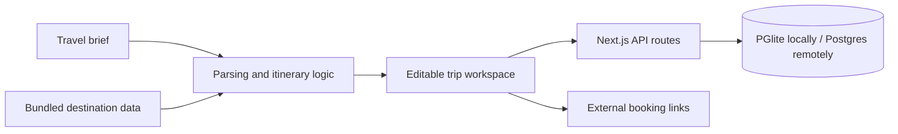

# TripMancer

TripMancer builds a trip around an activity you want to do. Search for a cooking class,
bookshops or a bike ride, set your departure city and group budget, and compare itineraries
that include a matching stop. The catalog covers 12 cities and eight departure airports.

Each result opens the same itinerary used to calculate its estimate. Edit the schedule,
compare stays or shorten a busy day by choosing a stop to keep and the hours available.
Preview which stops would go, how much time they take and what the group would save.
Visit durations exclude transfers and queues.

## Quick start

Use Node.js 22 LTS and npm. Dependency installation requires internet access.

```sh
npm ci
cp .env.example .env.local
npm run dev
```

Open [localhost:3000](http://localhost:3000), try **Cooking class** and select **Find trips**.
Leave `DATABASE_URL` empty to store local accounts in `.data/pglite/`. Guest trips stay
in the browser. Signed-in travelers can explicitly import device saves from **Trips**.
For password-account recovery, generate a one-time key in **Trips → Manage recovery key** and store it privately.

## Verification

`npm run build` uses the verified webpack production builder for consistent builds across supported environments.

Run `npm run verify` to execute lint, tests, route type generation, TypeScript checking,
and the production build in the same order as CI.

```sh
npm run lint
npm test
npm run typecheck
npm run build
npm start
```

Tests cover discovery-to-itinerary consistency, shorter-day budgets, brief parsing, season handling,
account isolation, recovery-key rotation, session revocation and database-backed storage. CI executes the checks above. A successful
build does not verify a hosted Postgres deployment or third-party booking services.

## Architecture



| Area | Implementation |
|---|---|
| App | Next.js App Router, React, TypeScript |
| Styling | Tailwind CSS and project stylesheets |
| Persistence | Embedded PGlite or Postgres through a shared query interface |
| Accounts | Password or Google OpenID Connect sign-in, salted scrypt password hashes, hashed session tokens |
| Planning | Field-weighted TF-IDF retrieval over activity descriptions, budget-constrained itinerary selection and time-constrained stop selection |
| Verification | Vitest, ESLint, TypeScript, production build |

## Configuration and deployment

See [.env.example](.env.example) for supported configuration. `DATABASE_URL` selects
Postgres and is required on Vercel. The embedded database needs persistent writable
storage and is intended for local development, not ephemeral serverless instances.
On first database access, the server creates its tables and enables row-level security.
Use a dedicated database and a server-only role that owns the app tables.

For Vercel with Supabase, create a Postgres project with the Data API disabled.
In **Connect**, select the transaction pooler and put its URI in the Vercel project's
sensitive `DATABASE_URL` environment variable. Supply the provider's PEM CA in
`DATABASE_CA_CERT` when the certificate chain needs it. Keep TLS verification enabled.
Deploy the local directory using the Vercel CLI. Check `/api/health` for
`{"ok":true,"database":"postgres"}`, then verify account creation and saving a trip over HTTPS.

Optional `NEXT_PUBLIC_*` affiliate IDs and URLs control outgoing links and are public
browser configuration. Keep database credentials in server-only environment variables.
Back up the embedded directory with the app stopped, or use your Postgres provider's
backup and restore tools. Verify restoration before relying on a deployment.

### Google sign-in

Google sign-in is deliberately off until it is configured. In Google Cloud Console, create a
**Web application** OAuth client and register the exact production callback URL:
`https://your-domain/api/auth/google/callback`. Set `GOOGLE_CLIENT_ID` and
`GOOGLE_CLIENT_SECRET` as server-only hosting variables and redeploy. The sign-in button
appears only when the server confirms both values are configured. The implementation uses the
authorization-code flow, validates the anti-forgery state and nonce, and verifies the
Google ID token signature, issuer, audience and expiry before creating a session. It requests
only `openid`, `email` and `profile`; it does not retain Google access or refresh tokens.

## Privacy and security

The app stores account identity, sign-in method, password hashes for password accounts, hashed sessions, saved trips and shortlists
only when a traveler creates an account or asks to save a plan. Guest plans remain in browser
storage. Signed-in travelers can download their account data or permanently delete their
account from [/privacy](/privacy). Account deletion removes server-side sessions, trips,
shortlists and recovery keys. Failed login records expire after one day.

Production uses secure, HTTP-only, same-site session cookies, verified database TLS,
cross-origin write protection, input limits, account-scoped data access and restrictive
browser security headers. The app does not include analytics or advertising cookies.

Set `NEXT_PUBLIC_PRIVACY_CONTACT_EMAIL` to an address that can receive privacy requests
before offering the service publicly. The privacy notice discloses Supabase, Vercel, Google, Unsplash
and the external booking providers. Review provider agreements, backup retention and the
applicable privacy law with qualified counsel before representing the service as legally compliant.

## Repository guide

- `src/app/`: pages and HTTP routes
- `src/components/`: planning, destination, and account interfaces
- `src/lib/`: brief parsing, planner, estimates, and client persistence
- `src/server/`: accounts, sessions, database, and saved records
- `src/data/`: destination catalog
- `src/styles/`: application styles

## Scope

Prices are typical estimates, not live inventory or guaranteed fares. Outgoing booking
links do not complete a reservation inside this app. Confirm current prices, entry
rules, and availability with the relevant provider before booking.

Public deployment needs HTTPS, tested database backups, monitoring, and a security
review of account abuse controls. Recovery uses a previously generated key. Email ownership verification requires an external delivery service and is outside the current implementation. This repository does not claim an independently audited production service.

See [CONTRIBUTING.md](CONTRIBUTING.md) and [SECURITY.md](SECURITY.md).

Behind a reverse proxy, set `APP_ORIGIN` to the external HTTPS origin used by the browser. Production session cookies require HTTPS. Remote PostgreSQL connections verify the server certificate.

## License

[MIT License](LICENSE) for the project code. Third-party software, models, and datasets retain their own terms.
